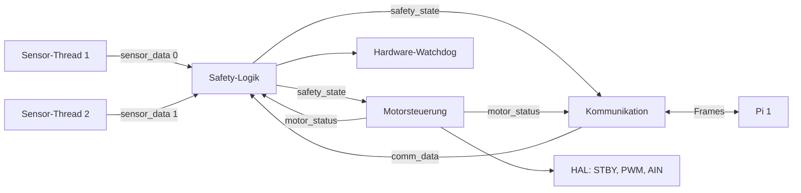

# Pi 2 – Überblick

Erstellt mit Unterstützung eines Sprachmodells (Claude Code, Claude Fable 5.2), geprüft von: <Name>

## Aufgabe

Pi 2 misst mit zwei HC-SR04 den Abstand zum Gefahrenbereich, prüft die Messwerte, trifft alle 50 ms die
Safety-Entscheidung und steuert den Motor über den TB6612FNG. Pi 1 liefert nur die Sollstufe und zeigt an.
Fällt Pi 1 oder die Verbindung aus, schaltet Pi 2 selbst ab.

## Module

| Datei | Aufgabe | Bezug |
|---|---|---|
| `src/pi2_safety/main_pi2.c` | Start, Thread-Verwaltung, Protokoll der Zustandswechsel, Beenden; im Testmodus Konsole und Test-Log | SAF-02, SAF-09, Abschnitt 2.10 |
| `src/pi2_safety/safety_logic.c` | Safety-Entscheidung je Zyklus, P3 und P4, Zustände | SAF-06, SAF-08, SAF-11 |
| `src/pi2_safety/sensors.c` | Sensor-Threads, P1 und P2 | SAF-03, SAF-04 |
| `src/pi2_safety/motor.c` | setzt die freigegebene Stufe um | SAF-01, SAF-07 |
| `src/pi2_safety/bt_server.c` | Empfang, Prüfung und Versand der Nachrichten | SAF-05, SEC-02, SEC-03 |
| `src/pi2_safety/shared.c` | gemeinsame Datensätze mit je einem Mutex | Designdokument 2.7 |
| `src/pi2_safety/watchdog.c` | Hardware-Watchdog des Raspberry Pi | Ergänzung zum Designdokument |
| `src/pi2_safety/hal.h` | Schnittstelle zur Hardware | Designdokument 2.13 |
| `src/pi2_safety/hal_pigpio.c` | Hardware über pigpio | Designdokument 2.13 |
| `src/pi2_safety/hal_sim.c` | simulierte Hardware für den PC | Entwicklung |
| `src/pi2_safety/pi2_config.h` | Pins, Takte, PWM-Stufen, Sicherheitsabstände, Prioritäten | Designdokument 2.13, SAF-07 |
| `src/common/` | Nachrichtenformat, Konstanten, Zeitbasis, Krypto-Platzhalter | Designdokument 2.8 |

Weitere Erklärungen: [Safety-Logik](erklaerung_pi2_safety_logik.md), [Sensoren](erklaerung_pi2_sensoren.md),
[Motor und Hardware](erklaerung_pi2_motor_hal.md), [Kommunikation](erklaerung_pi2_kommunikation.md).

## Threads

| Thread | Priorität (`SCHED_FIFO`) | Takt | schreibt | liest |
|---|---|---|---|---|
| Safety-Logik | 80 | 50 ms | `safety_state`, Watchdog | `sensor_data[2]`, `comm_data`, `motor_status` |
| Motorsteuerung | 70 | bei jedem neuen `safety_state`, spätestens nach 50 ms | Motorausgänge, `motor_status` | `safety_state` |
| Sensor 1, Sensor 2 | 60 | 60 ms, um 30 ms versetzt | `sensor_data[i]` | – |
| Kommunikation | 40 | `poll()` mit höchstens 50 ms | `comm_data` | `safety_state`, `sensor_data[2]`, `motor_status` |
| Hauptprogramm | normal | 10 ms | Konsole | `safety_state` |

## Gemeinsame Daten

Es gibt vier Datensätze: `sensor_data[2]`, `comm_data`, `safety_state` und `motor_status`. Für jeden gilt:

- Genau ein Thread schreibt, und jeder Datensatz hat einen eigenen Mutex mit `PTHREAD_PRIO_INHERIT`.
- Unter dem Mutex wird nur kopiert. Messen, Senden und GPIO-Zugriffe passieren außerhalb.
- Kein Thread hält zwei Mutexe gleichzeitig, deshalb kann kein Deadlock entstehen.
- Schlägt ein Lesezugriff fehl, liefert `shared.c` einen genullten Datensatz. Das bedeutet „ungültig“ bzw.
  Zustand INIT und führt zu Motor AUS.

`safety_state` hat zusätzlich eine Bedingungsvariable. Die Safety-Logik weckt damit nach jedem Zyklus die
Motorsteuerung, sodass eine Abschaltung nicht auf den nächsten Takt warten muss.

In `motor_status` meldet die Motorsteuerung zurück, welche Stufe sie tatsächlich umgesetzt hat und für
welche Generation von `safety_state`. Die Kommunikation braucht das für das ACK, die Safety-Logik für den
Watchdog.

## Ablauf von Start bis Ende

1. Das Programm prüft die Sicherheitsabstände (S_LOW < S_MEDIUM < S_HIGH) und auf dem Raspberry Pi die
   Root-Rechte. Fehlt etwas, startet es nicht.
2. `hal_init()` setzt zuerst STBY, AIN1, AIN2 und PWM auf AUS, danach werden die Sensor-Pins eingerichtet.
3. Signal-Handler, gemeinsame Daten und der lauschende Socket werden angelegt. Scheitert etwas, endet das
   Programm mit Motor AUS.
4. Auf dem Raspberry Pi wird der Hardware-Watchdog geöffnet. Ist er nicht verfügbar, endet das Programm.
5. Die fünf Threads starten. Lässt sich auf dem Raspberry Pi `SCHED_FIFO` nicht setzen, endet das Programm
   mit Motor AUS. Die Safety-Logik liefert FEHLER, bis beide Sensoren gültig sind und eine gültige
   Nachricht von Pi 1 vorliegt.
6. Im Betrieb protokolliert das Hauptprogramm jeden Wechsel von Zustand, Fehlercode oder Stufe.
7. Bei STOP von Pi 1, SIGINT oder SIGTERM geht die Safety-Logik in SHUTDOWN. Die Motorsteuerung schaltet ab
   und meldet „Motor AUS“. Erst danach sendet die Kommunikation das ACK.
8. Das Hauptprogramm beendet die Threads, gibt die Hardware frei und schließt den Watchdog. Konnte der Motor
   nicht abgeschaltet werden, bleibt der Watchdog offen und setzt den Pi zurück.

## Stellen, an denen man Fehler leicht übersieht

- In der Simulation sind fehlende Root-Rechte nur eine Warnung, auf dem Raspberry Pi ein Startfehler.
  `mlockall` wird ohne Root gar nicht aufgerufen, weil sonst das Speicherlimit das Anlegen der Threads verhindert.
- Der Testmodus ist ein eigenes Programm (`pi2_app_test`, Build mit `SSM_TESTMODE`). Im normalen `pi2_app`
  gibt es weder Konsole noch Fehlereinspeisung noch Test-Log.
- Die Testkonsole liest `stdin` ungepuffert. Mit Pufferung übersieht `poll()` bereits gelesene Zeilen.
- Das Test-Log `pi2_testlog.csv` entsteht im aktuellen Verzeichnis und wird bei jedem Start überschrieben.
- Der Hardware-Watchdog ist nur auf dem Raspberry Pi aktiv. In der Simulation wird er nicht geöffnet,
  damit er den Entwicklungsrechner nicht zurücksetzt.
- `--no-watchdog` ist nur für die Entwicklung gedacht. Ohne Watchdog läuft der Motor nach einem Absturz weiter.

## Abgleich mit `pi2_agent_prompt.md`

Stand 10.11.2026. Der Code entstand vor dem Auftrag. Die Punkte 1 bis 3 sind in der Gruppe noch zu klären. Erfüllt sind unter anderem: Safety-Entscheidung als
reine Funktion mit Unit-Tests, fünf Threads mit `SCHED_FIFO`, Prioritätsvererbung, `CLOCK_MONOTONIC`,
Bedingungsvariable zur Motorsteuerung, Session-ID zuerst, Prüfreihenfolge der Nachrichten, Abschalt- und
Einschaltreihenfolge am Motortreiber, kontrolliertes Beenden bei Signalen, keine dynamische
Speicherverwaltung.

| Nr. | Punkt im Auftrag | Stand im Code | Art |
|---|---|---|---|
| 1 | `common/` schreibt Pi 1 (`crypto`, `session`, `transport`) | eigenes `src/common/` ohne `session` und `transport`; Sockets liegen in `bt_server.c` | Absprache |
| 2 | Struktur `common/`, `pi1/`, `pi2/`, `docs/`, Makefile | `src/common/`, `src/pi2_safety/`, CMake (Build-System im Repo) | Absprache |
| 3 | GPIO über libgpiod, PWM über sysfs | pigpio (steht so in README und Installationsskripten) | Absprache |
| 4 | Hardware-Watchdog (Ergänzung 11) | umgesetzt in `watchdog.c`; am Raspberry Pi noch nicht getestet | erledigt |
| 5 | ACK erst, wenn die Motorsteuerung AUS gemeldet hat (Ergänzung 10, 13, SAF-09) | umgesetzt über `motor_status`; ohne Bestätigung innerhalb von 500 ms kein ACK | erledigt |
| 6 | Sequenznummer `UINT32_MAX` beendet die Verbindung (Designdokument 5.2) | umgesetzt in `send_frame()` | erledigt |
| 7 | Authentische Nachricht mit ungültigem Inhalt setzt sofort KOMMUNIKATION (Ergänzung 6) | umgesetzt in `handle_frame()` | erledigt |
| 8 | P2: erste Messung wird nicht geprüft und gilt (Ergänzung 4) | umgesetzt in `sensor_check_sample()` | erledigt |
| 9 | P3: Bewertung, sobald ein Sensor einen neuen Wert hat (Ergänzung 5) | umgesetzt in `safety_logic.c` | erledigt |
| 10 | Testmodus nur per Compile-Flag, Test-Log in Datei, Nachlaufmessung (Ergänzung 17) | umgesetzt: `pi2_app_test` mit `SSM_TESTMODE`, `pi2_testlog.csv`, Befehl `run`. Die Nachlaufmessung ersetzt nur den Befehl von Pi 1, die Sensorprüfungen bleiben aktiv. | erledigt |
| 11 | Fehlende Rechte führen zum Abbruch; Zyklusüberschreitungen zählen (Ergänzung 14) | umgesetzt; in der Simulation bleibt es bei einer Warnung | erledigt |
| 12 | S = 30 / 50 / 80 cm, Prüfung der Reihenfolge beim Start (Ergänzung 9) | umgesetzt in `pi2_config.h` und `safety_config_valid()` | erledigt |
| 13 | Gemeinsamer Startzeitpunkt der Sensor-Threads (Ergänzung 3) | umgesetzt (`sensors_set_start_time()`), Echo-Timeout 25 ms | erledigt |
| 14 | AES-256-GCM über OpenSSL | CRC-Platzhalter in `crypto_utils.c` | offen bis `common/` von Pi 1 |
| 15 | Simulierter Pi 1 in C mit `common/` | `tools/pi1_sim.py` | Werkzeug |
| 16 | `-Werror`, Abweichungen im README | `-Werror` gesetzt; Liste der Abweichungen in `documents/misra_konformitaet_pi2.md` statt im README | teilweise |
| 17 | MISRA: Kategorie Mandatory | geprüft werden die neun Regeln aus `MISRA_C_verpflichtende_Regeln.pdf` (Festlegung der Gruppe) | entschieden |
