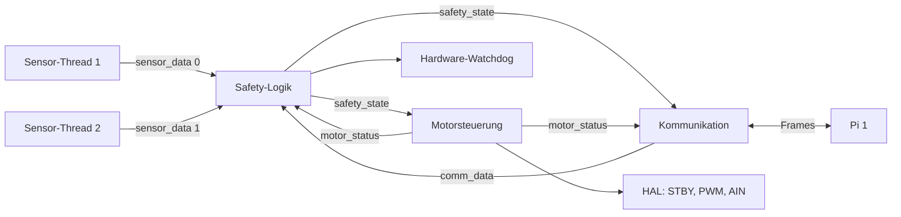

# Pi 2 – Überblick

Erstellt mit Unterstützung eines Sprachmodells (Claude Code, Claude Fable 5.2 und Claude Opus 5.5), geprüft von: <Name>

## Aufgabe

Pi 2 misst mit zwei HC-SR04 den Abstand zum Gefahrenbereich, prüft die Messwerte, trifft alle 50 ms die
Safety-Entscheidung und steuert den Motor über den TB6612FNG. Pi 1 liefert nur die Sollstufe und zeigt an.
Fällt Pi 1 oder die Verbindung aus, schaltet Pi 2 selbst ab.

Verweise in diesen Dokumenten beziehen sich auf die IDs im Designdokument: Anforderungen (SAF, SEC), Hazards
(H), Plausibilitätsprüfungen (P), Bedrohungen (T) und Testfälle (TC). Wo es keine ID gibt, steht die
Abschnittsnummer des Designdokuments.

## Module

| Datei | Aufgabe | Bezug |
|---|---|---|
| `src/pi2_safety/main_pi2.c` | Start, Thread-Verwaltung, Protokoll der Zustandswechsel, Beenden; im Testmodus Konsole und Test-Log | SAF-02, SAF-09 |
| `src/pi2_safety/safety_logic.c` | Safety-Entscheidung je Zyklus, P3 und P4, Zustände | SAF-06, SAF-08, SAF-11 |
| `src/pi2_safety/sensors.c` | Sensor-Threads, P1 und P2 | SAF-03, SAF-04 |
| `src/pi2_safety/motor.c` | setzt die freigegebene Stufe um | SAF-01, SAF-07 |
| `src/pi2_safety/bt_server.c` | Empfang, Prüfung und Versand der Nachrichten | SAF-05, SEC-02, SEC-03 |
| `src/pi2_safety/shared.c` | gemeinsame Datensätze mit je einem Mutex | Abschnitt 2.7 |
| `src/pi2_safety/watchdog.c` | Hardware-Watchdog des Raspberry Pi | Ergänzung zum Design |
| `src/pi2_safety/hal.h` | Schnittstelle zur Hardware | Abschnitt 2.13 |
| `src/pi2_safety/hal_pigpio.c` | Hardware über pigpio | Abschnitt 2.13 |
| `src/pi2_safety/hal_sim.c` | simulierte Hardware für den PC | Entwicklung |
| `src/pi2_safety/pi2_config.h` | Pins, Takte, PWM-Stufen, Sicherheitsabstände, Prioritäten | SAF-07, Abschnitt 2.13 |
| `src/common/` | gemeinsamer Code mit Pi 1: Nachrichtenformat, AES-256-GCM, Session, Transport, Klartextnamen, Konstanten, Zeitbasis | SEC-01 bis SEC-03 |

Weitere Erklärungen: [Safety-Logik](safety_logik.md), [Sensoren](sensoren.md),
[Motor und Hardware](motor_hal.md), [Kommunikation](kommunikation.md). Was noch offen ist und wo der Code
vom Auftrag abweicht, steht in [stand.md](stand.md).

## Begriffe

| Begriff | Bedeutung |
|---|---|
| HAL | Hardware-Abstraktion: alle Zugriffe auf GPIO und PWM hinter einer Schnittstelle (`hal.h`), damit derselbe Code auf dem Pi und in der Simulation läuft |
| Snapshot | lokale Kopie eines gemeinsamen Datensatzes; der Leser arbeitet nur mit der Kopie, der Mutex ist nur beim Kopieren gesperrt |
| Generation | Zähler in `safety_state`, den die Safety-Logik in jedem Zyklus um 1 erhöht; daran erkennt die Motorsteuerung neue Entscheidungen, und die Safety-Logik erkennt, ob die Motorsteuerung mitkommt |
| `SCHED_FIFO` | Echtzeit-Scheduling von Linux: Ein Thread mit höherer Priorität verdrängt alle niedrigeren sofort |
| Prioritätsvererbung | Hält ein niedrig priorisierter Thread einen Mutex, den ein höher priorisierter braucht, läuft er so lange mit dessen Priorität (`PTHREAD_PRIO_INHERIT`) |
| monotone Uhr | `CLOCK_MONOTONIC`: zählt nur vorwärts und springt nicht bei einer Uhrzeitänderung; Grundlage aller Timeouts |
| Watchdog | Hardware-Zeitgeber, der den Pi zurücksetzt, wenn das Programm ihn nicht regelmäßig bedient |
| Magic Close | das Zeichen `V` vor dem Schließen von `/dev/watchdog`; ohne dieses Zeichen löst der Watchdog trotz Schließen aus |
| Testmodus | eigenes Programm `pi2_app_test` mit Fehlereinspeisung und Test-Log; im normalen `pi2_app` nicht enthalten |

## Threads

| Thread | Priorität (`SCHED_FIFO`) | Takt | schreibt | liest |
|---|---|---|---|---|
| Safety-Logik | 80 | 50 ms | `safety_state`, Watchdog | `sensor_data[2]`, `comm_data`, `motor_status` |
| Motorsteuerung | 70 | bei jedem neuen `safety_state`, spätestens nach 50 ms | Motorausgänge, `motor_status` | `safety_state` |
| Sensor 1, Sensor 2 | 60 | 60 ms, um 30 ms versetzt | `sensor_data[i]` | – |
| Kommunikation | 40 | wartet höchstens 50 ms | `comm_data` | `safety_state`, `sensor_data[2]`, `motor_status` |
| Hauptprogramm | normal | 10 ms | Ausgabe der Zustandswechsel | `safety_state` |

## Gemeinsame Daten

Es gibt vier Datensätze: `sensor_data[2]`, `comm_data`, `safety_state` und `motor_status`. Für jeden gilt:

- Genau ein Thread schreibt, und jeder Datensatz hat einen eigenen Mutex mit Prioritätsvererbung.
- Unter dem Mutex wird nur kopiert. Messen, Senden und GPIO-Zugriffe passieren außerhalb.
- Kein Thread hält zwei Mutexe gleichzeitig, deshalb kann kein Deadlock entstehen.
- Schlägt ein Lesezugriff fehl, liefert `shared.c` einen genullten Datensatz. Das bedeutet „ungültig“ bzw.
  Zustand INIT und führt zu Motor AUS.

`safety_state` hat zusätzlich eine Bedingungsvariable. Die Safety-Logik weckt damit nach jedem Zyklus die
Motorsteuerung, sodass eine Abschaltung nicht auf den nächsten Takt warten muss.

In `motor_status` meldet die Motorsteuerung zurück, welche Stufe sie tatsächlich umgesetzt hat und für
welche Generation. Die Kommunikation braucht das für das ACK, die Safety-Logik für den Watchdog.

## Ablauf von Start bis Ende

1. **Voraussetzungen:** Das Programm prüft die Sicherheitsabstände (S_LOW < S_MEDIUM < S_HIGH), auf dem
   Raspberry Pi die Root-Rechte und lädt den Schlüssel (`--key`, Standard `/etc/ssm/psk.bin`, SEC-01). Fehlt
   etwas, startet es nicht und berührt die Ausgänge nicht.
2. **Hardware:** `hal_init()` setzt zuerst STBY, AIN1, AIN2 und PWM auf AUS, danach werden die Sensor-Pins
   eingerichtet (SAF-02).
3. **Initialisierung:** Signal-Handler, gemeinsame Daten, lauschender Socket, Speichersperre und auf dem
   Raspberry Pi der Hardware-Watchdog. Scheitert etwas, wird alles freigegeben und das Programm endet mit
   Motor AUS.
4. **Threads:** Die fünf Threads starten. Lässt sich auf dem Raspberry Pi `SCHED_FIFO` nicht setzen, endet
   das Programm mit Motor AUS. Die Safety-Logik liefert FEHLER, bis beide Sensoren gültig sind und eine
   gültige Nachricht von Pi 1 vorliegt.
5. **Betrieb:** Das Hauptprogramm gibt jeden Wechsel von Zustand, Fehlercode oder Stufe aus.
6. **Stop:** Bei STOP von Pi 1, SIGINT oder SIGTERM geht die Safety-Logik in SHUTDOWN. Die Motorsteuerung
   schaltet ab und meldet „Motor AUS“. Kam der Stop von Pi 1, sendet die Kommunikation erst danach das ACK
   (SAF-09). Bei einem Signal bekommt Pi 1 nur den letzten STATUS mit SHUTDOWN.
7. **Ende:** Das Hauptprogramm beendet die Threads, gibt Kommunikation, Kryptografie und Hardware frei und
   schließt den Watchdog. Konnte der Motor nicht abgeschaltet werden, bleibt der Watchdog offen und setzt den
   Pi zurück.

## Stellen, an denen man Fehler leicht übersieht

- In der Simulation sind fehlende Root-Rechte nur eine Warnung, auf dem Raspberry Pi ein Startfehler.
  `mlockall` wird ohne Root gar nicht aufgerufen, weil sonst das Speicherlimit das Anlegen der Threads verhindert.
- Der Testmodus ist ein eigenes Programm. Im normalen `pi2_app` gibt es weder Konsole noch Fehlereinspeisung
  noch Test-Log.
- Die Testkonsole liest `stdin` ungepuffert. Mit Pufferung übersieht `poll()` bereits gelesene Zeilen.
- Das Test-Log `pi2_testlog.csv` entsteht im aktuellen Verzeichnis und wird bei jedem Start überschrieben.
- Der Hardware-Watchdog ist nur auf dem Raspberry Pi aktiv. In der Simulation wird er nicht geöffnet,
  damit er den Entwicklungsrechner nicht zurücksetzt.
- `--no-watchdog` ist nur für die Entwicklung gedacht. Ohne Watchdog läuft der Motor nach einem Absturz weiter.

## Betrieb am Aufbau

- Ohne Echo bleibt das System in FEHLER / SENSOR. Im Messbereich (bis 4 m) muss deshalb eine Rückwand stehen.
- Pi 1 sendet erst Heartbeats, wenn der Bediener eine Stufe gewählt hat. Bis dahin steht Pi 2 in
  FEHLER / KOMMUNIKATION. Das ist beabsichtigt.
- Beide Pis brauchen dieselbe Schlüsseldatei (32 Byte, Rechte 0600), erzeugt mit `tools/gen_psk.sh`.
